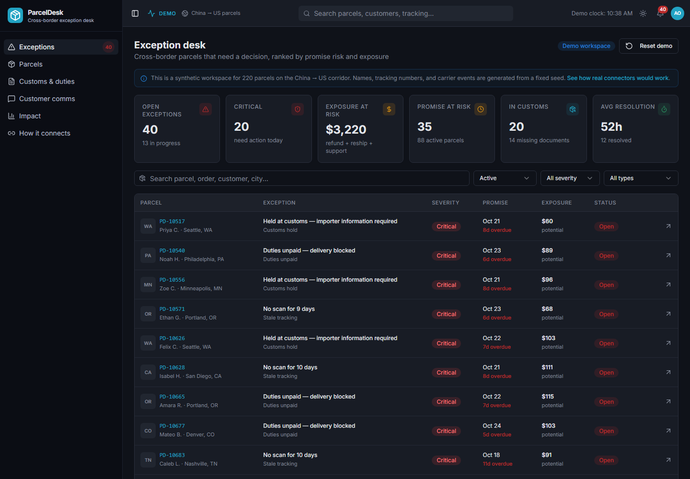
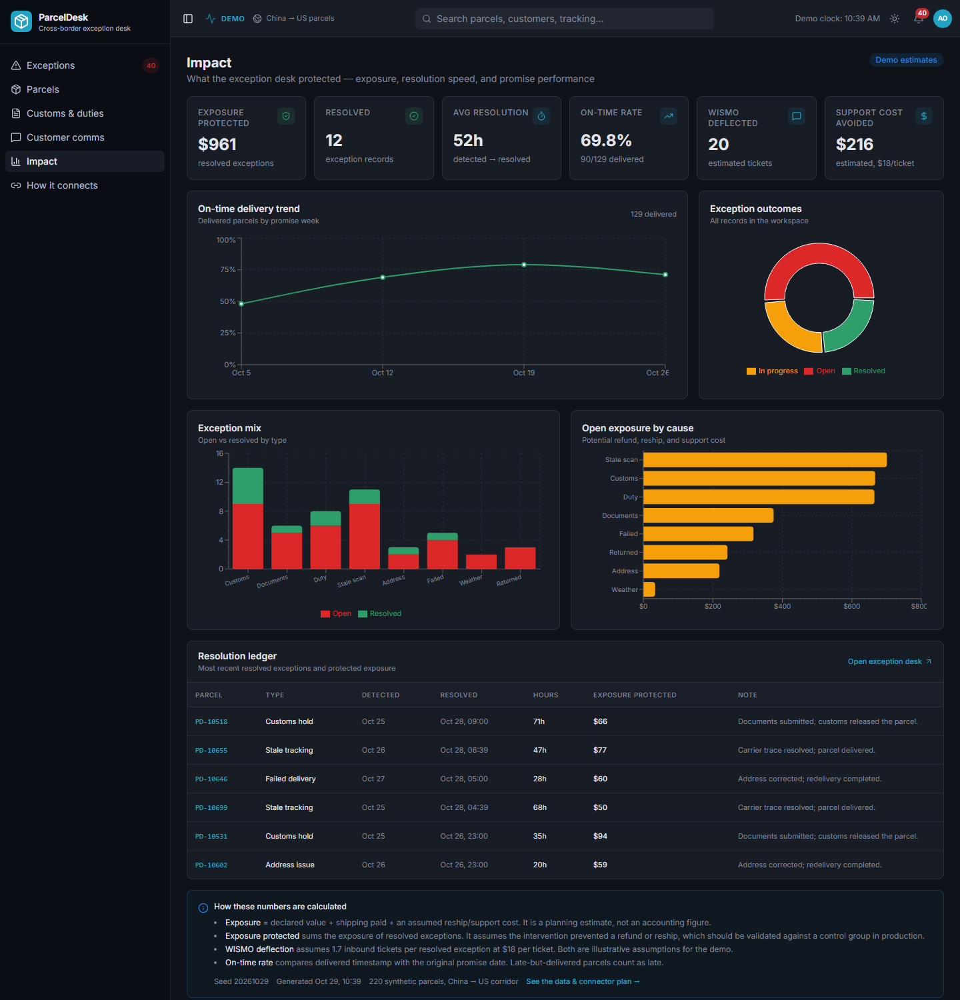

# ParcelDesk

**A cross-border exception desk for small e-commerce merchants.** ParcelDesk turns messy China → US parcel events into a prioritized queue of decisions: which customs hold to fix, which stale scan to trace, which customer to update, and what the intervention protected.

> **Demo status:** This is a portfolio product, not a live deployment. The workspace contains 220 synthetic parcels generated from seed `20261029`. Names, tracking numbers, carrier scans, customs entries, and customer messages are fabricated. No customer data, carrier credentials, or live APIs are used. See the **How it connects** page inside the app for the full data and integration story.



## The problem

A 5–20 person DTC brand shipping from China to the US does not need another tracking map. It needs an operating answer to one question:

> **A parcel broke. What do I do next, and how do I tell the customer before they open a ticket?**

The hard cases are cross-border-specific:

- Customs holds with missing invoices, HS codes, or importer details.
- Duties and taxes that block release and surprise the customer.
- Carrier handoffs where the last scan goes quiet for days.
- Address and delivery failures that turn into returns.
- Customers who expect a domestic experience while the parcel crosses three systems.

Generic control towers show everything. ParcelDesk shows **what needs a decision now**, gives the operator a recommended action, drafts the customer update, and records the outcome.

## The first working slice

| Surface | Route | What it does |
| --- | --- | --- |
| **Exception desk** | `/` | Ranked queue of open exceptions with severity, promise risk, exposure, customs context, and owner. Filter by status, severity, and type; search by parcel, customer, or city. |
| **Parcels** | `/parcels` | Searchable, filterable, paginated view of all 220 parcels with carrier chain, status, risk, promise performance, and last scan. |
| **Parcel detail** | `/parcels/:parcelId` | Golden path: exception summary, recommended action, full tracking timeline, customs case, editable customer message, and resolution dialog. |
| **Customs & duties** | `/customs` | Held parcels, duty-due cases, missing documents, customs dwell, and cleared entries. |
| **Customer comms** | `/comms` | Draft and sent updates with localized templates (English/Spanish), message preview, copy, and one-click send simulation. |
| **Impact** | `/impact` | Exposure protected, resolution time, on-time trend, exception mix, open exposure by cause, and a resolution ledger — all derived from the same records. |
| **How it connects** | `/connections` | The operating loop, 8 connector cards (6 simulated, 2 planned), what is real vs simulated, the data-generation method, and the production path. |

### Working behavior

- Exceptions can be **acknowledged**, **resolved with an audit note**, and **sent to the customer**.
- Every action writes an ops event to the parcel timeline.
- Resolving an exception clears it from the queue, updates the customs case, drops the risk score, zeroes the open exposure, and adds to the impact ledger.
- The workspace persists to `localStorage`; **Reset demo** regenerates a fresh seeded workspace.
- Top-bar search finds parcels by ID, order, tracking number, customer, product, or destination city.
- The theme toggle and collapsible sidebar are preserved from the original design system.

## Product decisions

| Decision | Choice | Why |
| --- | --- | --- |
| Primary user | SMB DTC merchant ops lead | Narrow enough for a portfolio case study; painful enough to buy. |
| Corridor | China → US | Concentrates customs friction, carrier handoffs, and duty surprises. |
| Scope | Exception queue + parcel detail + customs + comms + impact | One coherent operating loop instead of nine disconnected modules. |
| Data | Deterministic synthetic seed | Honest demo, reproducible screenshots, no fake "live" claims. |
| Action model | Human-in-the-loop recommendations | The product assists the operator; it does not pretend to automate customs. |
| Brand | ParcelDesk | The repo remains `resilichain-ai`; the product inside is ParcelDesk. |

## Data model

`src/data/parcels.ts` is the source of truth. It exports:

- `Parcel` — order, customer, route, carrier chain, service, product, declared value, promise date, predicted date, status, risk score, exposure, events, customs case, exception, and customer message.
- `TrackingEvent` — timestamp, canonical milestone, raw description, location, carrier, and source (`carrier_scan`, `customs`, `merchant`, `ops`).
- `ParcelException` — type, severity, reason, detected time, status, owner, exposure, and a `RecommendedAction` with confidence, cost, and SLA.
- `CustomsCase` — status (`pending`, `held`, `duty_due`, `cleared`), entry number, broker, duty/tax, missing documents, hold and clearance timestamps.
- `CustomerMessage` — channel, language, subject, body, draft/sent status.
- `WorkspaceMetrics` — queue, exposure, promise, customs, resolution, and deflection metrics.

`generateWorkspace(seed, now)` creates the dataset. The generator walks each parcel through a realistic timeline, then injects exception scenarios based on weighted probabilities. Roughly one in four parcels hits an exception; a portion is pre-resolved so the impact surface has history.

### Risk and exposure

- **Risk score (0–100):** severity base + promise proximity + stale-scan penalty + declared-value escalation. It is transparent rules, not a trained model.
- **Exposure:** declared value + shipping paid + an assumed reship/support cost. Duty cases add the duty and tax amount. This is a planning estimate, not an accounting figure.
- **On-time:** delivered timestamp ≤ original promise date.
- **WISMO deflection:** 1.7 estimated inbound tickets per resolved exception at $18 per ticket. Both are illustrative demo assumptions.

### What changes with real integrations

The demo uses a local store. In production, the same UI would read from normalized carrier events and write to a broker/comms system:

| Connector | Data it would provide |
| --- | --- |
| Storefront (Shopify/WooCommerce) | Order, SKU, HS code, address, service, promise date |
| Origin carriers (YunExpress/4PX/Cainiao/DHL eCommerce/SF) | Pickup, export, linehaul, handoff scans |
| Last-mile carriers (USPS/UPS) | Import scan, out-for-delivery, attempt, delivery |
| Aggregator (AfterShip/17TRACK) | One normalized milestone stream and exception codes |
| Customs broker | Entry number, hold reason, missing docs, duty/tax |
| Comms (Postmark/Klaviyo/WhatsApp) | Send approved updates, capture replies |
| 3PL / returns | Domestic reship availability and return disposition |
| Warehouse (Postgres/BigQuery) | Audit trail and holdout evaluation |

## Tech stack

- **React 18** + **TypeScript 5**
- **Vite 5** with the SWC React plugin
- **Tailwind CSS 3** and **shadcn/ui** on Radix primitives
- **Recharts 3** for impact charts
- **React Router 6**
- **TanStack Query 5** provider (ready for a future API layer)
- **Vitest** + **Testing Library** with jsdom

## Getting started

```bash
git clone https://github.com/fouzzwont/resilichain-ai.git
cd resilichain-ai
npm install
npm run dev
```

Open **http://localhost:8080** (the Vite config binds port `8080`, host `::`).

### Quality checks

```bash
npm test           # generator, exception, metric, and formatting tests
npm run build      # production bundle in dist/
npm run lint       # ESLint 9
```

### Scripts

| Script | Purpose |
| --- | --- |
| `dev` | Start the Vite dev server on port 8080 |
| `build` | Production build via Vite |
| `build:dev` | Development-mode build |
| `preview` | Preview the built `dist/` output |
| `test` | Run Vitest once |
| `test:watch` | Run Vitest in watch mode |
| `lint` | Lint the project |

## Project structure

```text
.
├── docs/                          # Screenshots used in this README
├── public/
├── src/
│   ├── components/
│   │   ├── ui/                    # shadcn/ui primitives
│   │   ├── AppLayout.tsx          # Sidebar + top bar shell
│   │   ├── AppSidebar.tsx         # ParcelDesk navigation
│   │   ├── TopBar.tsx             # Global search, demo clock, theme, queue badge
│   │   ├── KpiCard.tsx            # Metric card
│   │   ├── ParcelTimeline.tsx     # Normalized event timeline + stale warning
│   │   ├── RiskBadge.tsx          # Risk pill
│   │   └── StatusBadge.tsx        # Parcel/exception/severity pills
│   ├── data/parcels.ts            # Domain model, seeded generator, metrics, formatters
│   ├── state/WorkspaceProvider.tsx# Local persistence + queue actions
│   ├── pages/                     # Six product surfaces
│   ├── test/                      # Vitest setup and parcel tests
│   ├── App.tsx                    # Providers + routes
│   ├── main.tsx
│   └── index.css
├── index.html
├── tailwind.config.ts
├── vite.config.ts
└── vitest.config.ts
```

## Impact view



The impact surface is calculated from the same records the operator acts on, so acknowledging, resolving, or sending an update changes the numbers immediately.

## Deployment

`npm run build` produces a static `dist/`. Because the app uses `BrowserRouter`, configure SPA fallback so deep links serve `index.html`:

- **Netlify:** `/* /index.html 200`
- **Vercel:** rewrite all routes to `/index.html`
- **Static hosts:** enable single-page-application mode

## Limitations and next steps

- **Synthetic data only.** No real carrier, customs, or customer data. The reset button regenerates the seed.
- **Sending is simulated.** No email, SMS, or WhatsApp is actually delivered.
- **Impact is an estimate.** Exposure protected, WISMO deflection, and support-cost avoided need a holdout group to validate.
- **Customs rules are simplified.** Real de minimis, duty, and importer-of-record rules vary by product and date.
- **Next:** read-only tracking ingestion from one aggregator and one origin carrier; broker document requests; merchant-approved comms; holdout-based impact measurement.

## Repo note

The GitHub repository is still `fouzzwont/resilichain-ai` to preserve history and links. The product inside was pivoted from a generic supply-chain control tower to ParcelDesk, a cross-border exception desk for SMB merchants.
